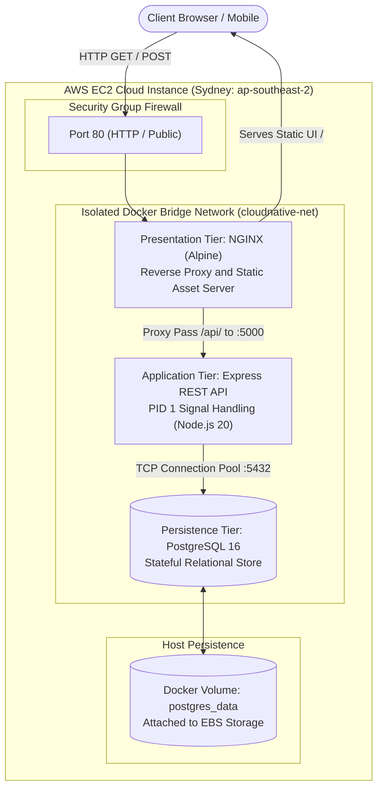
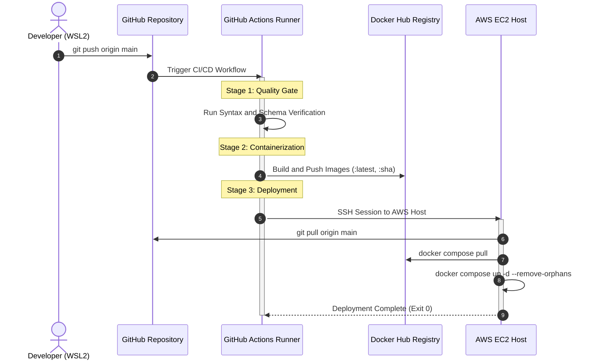

# CloudNative 3-Tier Enterprise Infrastructure Platform


---

## 📌 Executive Architecture Overview

This repository hosts a production-grade, containerized **3-Tier Web Infrastructure** designed with cloud-native engineering principles. The platform features an automated Continuous Integration & Continuous Deployment (CI/CD) lifecycle, stateful database persistence, isolated internal network bridging, and an NGINX reverse-proxy tier deployed onto **Amazon Web Services (AWS EC2)**.



---

## 🏗️ 3-Tier Architectural Specifications

### 1. Presentation Tier (Frontend / Web Server)
* **Technology:** NGINX Alpine Linux (~25MB image footprint).
* **Role:** High-throughput static file server and gateway reverse proxy.
* **Network Binding:** Host Port `80` mapped to Container Port `80`.
* **Routing Logic:**
  * Request path `/` -> Dispatches client storefront UI.
  * Request path `/api/` -> Proxies upstream to `http://backend:5000/api/` with forwarded client headers.

### 2. Application Logic Tier (Backend API)
* **Technology:** Node.js 20 LTS, Express Framework.
* **Security Hardening:**
  * Multi-Stage Dockerfile separating build dependencies from the runtime image.
  * Drops root privileges to unprivileged user `node` (UID `1000`).
  * Exec-form entrypoint (`CMD ["node", "server.js"]`) ensuring direct `SIGTERM` signal propagation for graceful database pool teardowns.

### 3. Persistence Tier (Stateful Relational Store)
* **Technology:** PostgreSQL 16 Alpine.
* **Data Integrity:** Automated seed script mounted via `/docker-entrypoint-initdb.d/init.sql` populating 162 catalog records.
* **Storage:** Docker Named Volume `postgres_data` guarantees zero data loss across container teardowns.

---

## 🚀 Automated CI/CD Lifecycle (GitOps Automation)



### Pipeline Quality Gates:
1. **Lint & Syntax Validation:** Evaluates JavaScript AST integrity using `node --check` before triggering container compilation.
2. **Deterministic Buildx Compilation:** Employs Docker Buildx layer caching for sub-minute container builds.
3. **Automated SSH Orchestration:** Authenticates via non-interactive RSA keys to trigger remote Rolling Container Re-spawns.

---

## ⚙️ Quick Start Guide

### Local Deployment
```bash
# 1. Clone repository
git clone https://github.com/abdullahmasaud10/cloudnative-3tier-platform.git
cd cloudnative-3tier-platform

# 2. Spin up the full 3-tier platform
docker compose up -d

# 3. Access endpoints
# Web UI:       http://localhost:80
# API Health:   http://localhost:80/health
# Catalog API:  http://localhost:80/api/products
```

### Remote AWS Production Access
* **Base URL:** `http://16.178.157.45`
* **Health Check Probe:** `http://16.178.157.45/health`

---

## 🛡️ Security Architecture Matrix

| Dimension | Implementation | Risk Mitigation |
| :--- | :--- | :--- |
| **Identity & Access** | Linux Non-Root User (UID `1000`) | Mitigates Container-to-Host privilege escalation / breakout exploits |
| **Ingress Control** | AWS Security Groups (`0.0.0.0/0` on Ports 80 & 22) | Port 5432 and 5000 are shielded from brute-force exposure |
| **Network Isolation** | Private Docker Bridge (`cloudnative-net`) | Establishes zero-trust container-to-container boundary |
| **Secret Encryption** | GitHub Actions Encrypted Secrets Vault | Eliminates credential leakage in version control manifests |

---

## 👨‍💻 Maintainer
**Abdullah Masaud**  
*Cloud & Infrastructure Engineer | Computer Engineering Graduate*  
* GitHub: [@abdullahmasaud10](https://github.com/abdullahmasaud10)
